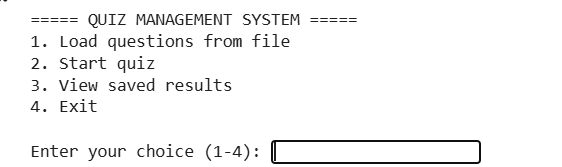
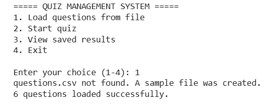
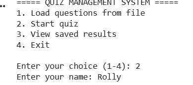
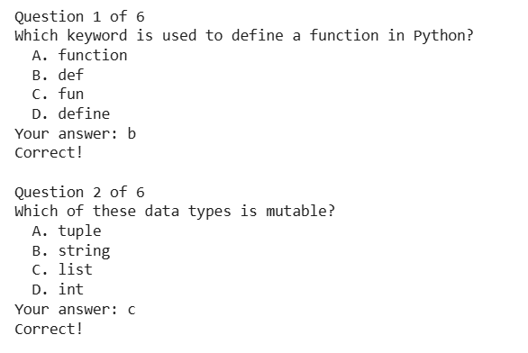
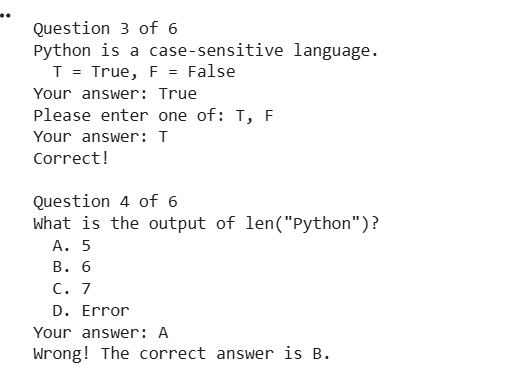
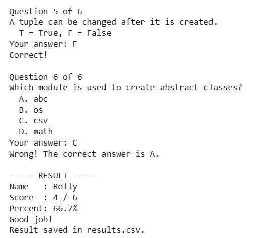
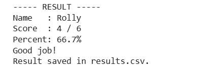
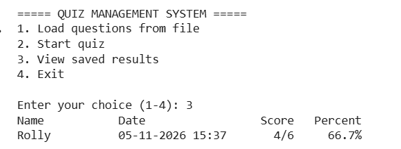
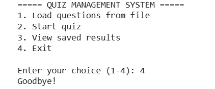

# Quiz Management System

A simple console-based Quiz Management System written in Python. It is built using Object-Oriented Programming (OOP) concepts. It loads questions from a CSV file, conducts a quiz, calculates the score, and saves the results in a CSV file.

## What the project does

This project lets a user take a quiz on the computer. The questions are read from a file, so they can be changed without touching the code. The user answers each question, the program checks the answers, calculates the score and percentage, and saves the result. The saved results can be viewed later from the menu.

## How the project works

1. The user selects **Load questions from file** from the menu. The program reads the questions from `questions.csv`. If the file does not exist, a sample file with 6 Python questions is created automatically.
2. There are two types of questions:
   - **Multiple choice (MCQ):** four options, answered with A, B, C, or D.
   - **True/False (TF):** answered with T or F.
3. The user selects **Start quiz** and enters their name. The program asks every question one by one. If the user enters an invalid answer, it asks again.
4. After each answer, the program shows whether it was correct. If it was wrong, the correct answer is shown.
5. At the end, the program calculates the score and the percentage and shows a message: **Excellent!** (80% or more), **Good job!** (50% or more), or **Keep practicing!** (below 50%).
6. The result (name, date, score, total, percentage) is saved automatically in `results.csv`.
7. The user can select **View saved results** to see all previous attempts.
8. Invalid rows in the questions file are skipped, and errors such as a missing file or loading nothing are handled with exception handling, so the program does not crash.

**Format of `questions.csv`:**

```
type,question,option_a,option_b,option_c,option_d,answer
MCQ,Which keyword is used to define a function in Python?,function,def,fun,define,B
TF,Python is a case-sensitive language.,,,,,T
```

The last column is the correct answer: A to D for MCQ, and T or F for True/False.

## How to run the project

**Requirements:** Python 3.8 or above. No extra libraries are needed.

**On your computer:**

```
python quiz_management_system.py
```

**On Google Colab:**

1. Paste the code into a cell and run it.
2. Choose option 1 to load the questions, then option 2 to start the quiz.
3. The `questions.csv` and `results.csv` files will be created in the Colab files panel.

## Classes used

| Class | Type | Purpose |
|---|---|---|
| `QuizError` | Custom exception | Raised when an action cannot be completed (questions not loaded, empty name, no valid questions, etc.) |
| `Question` | Abstract base class (`abc`) | Defines the common structure for all questions, with private attributes and abstract methods `valid_answers()` and `display()` |
| `MultipleChoiceQuestion` | Derived class | Inherits from `Question`. Has four options and accepts A, B, C, or D |
| `TrueFalseQuestion` | Derived class | Inherits from `Question`. Accepts T or F |
| `Quiz` | Manager class | Loads the questions, conducts the quiz, calculates the score, and saves and loads the results |

## Main features implemented

- **Load questions from a file:** reads MCQ and True/False questions from `questions.csv`
- **Conduct a quiz:** asks every question and checks the answers
- **Calculate score:** shows the score, the percentage, and a feedback message
- **Save results:** stores every attempt in `results.csv`
- **View saved results:** displays all previous attempts

## OOP concepts demonstrated

| Concept | Where it is used |
|---|---|
| Classes & Objects | `Question`, `MultipleChoiceQuestion`, `TrueFalseQuestion`, `Quiz` |
| Encapsulation | Private attributes (`__text`, `__correct_answer`, `__options`) with getters and setters using `@property` |
| Inheritance | `MultipleChoiceQuestion` and `TrueFalseQuestion` inherit from `Question` |
| Abstraction | `Question` is an abstract class using the `abc` module |
| File Handling | Questions are read from `questions.csv`, and results are written to `results.csv` |
| Exception Handling | `QuizError`, `OSError`, `KeyError`, and `ValueError` are handled |

## Program output (Screenshots)

### 1. Main menu
The program shows the menu and asks the user to enter a choice.



### 2. Load questions a sample file is created for the questions (Choice 1)
The questions are loaded from the file and the number of questions are asked .



### 3. Conducting the quiz (Choice 2)
The user enters their name and answers the questions one by one.



### 4. Correct and wrong answers
The program shows whether each answer is correct and displays the right answer if it is wrong.





### 5. Score and result
The score, percentage, and feedback message are displayed, and the result is saved.



### 6. View saved results (Choice 3)
All saved attempts are displayed with the name, date, score, and percentage.



### 7. Exit (Choice 4)
The program closes.



## Project files

```
quiz_management_system/
├── quiz_management_system.py   # main program
├── questions.csv               # quiz questions
├── results.csv                 # saved quiz results
├── screenshots/                # output screenshots
└── README.md                   # project documentation
```
